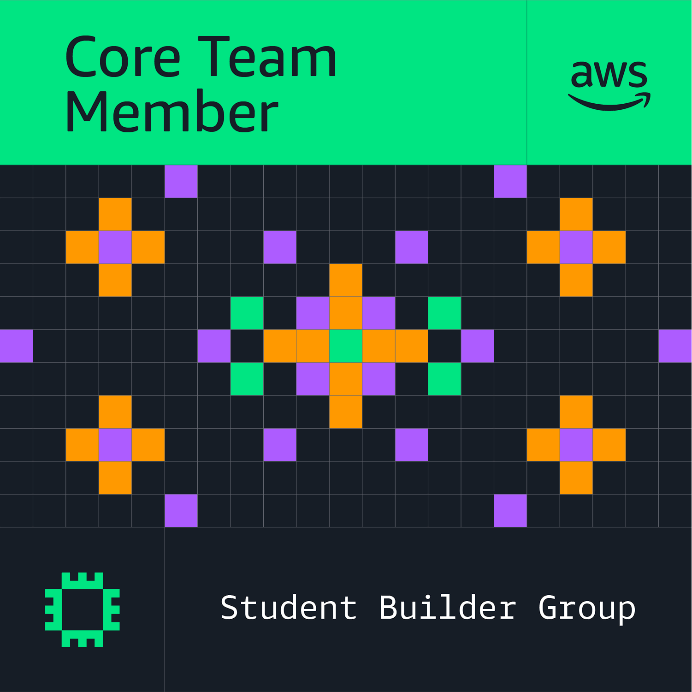

<!-- 헤더 -->

  

  

 

## Tech Stack

| 분야 | 구분 | 기술 |
| :--- | :--- | :--- |
| **Languages** | 주력 |     |
| **ML / Data** | 주력 |  |
| | 활용 경험 |     |
| | 학습 경험 |    |
| **Backend** | 주력 |  |
| | 활용 경험 |   |
| **Frontend** | 활용 경험 |  |

### Tools & Platforms

| 구분 | 사용 도구·플랫폼 |
| :--- | :--- |
| **Infra / Tools** |    |
| **Platforms** |     |

### AI Models & Inference

| 구분 | 모델·도구 | 사용 경험 |
| :--- | :--- | :--- |
| **Models** |  | 의료 텍스트 관련 로컬 모델 실험 |
| |  | 온디바이스 캠퍼스 검색 프로젝트 |
| **Local Inference** |  | 로컬 LLM 실행·프로그램 연동 |
| **Serving · 학습 중** |  | LLM 추론·서빙 방식 학습 |

### Currently Learning

`Transformer / LoRA` · `Backend.AI`

 

## Activity

### AWS Student Builder Groups

## If you want to Contact...

  

## See my BLOG!

  

